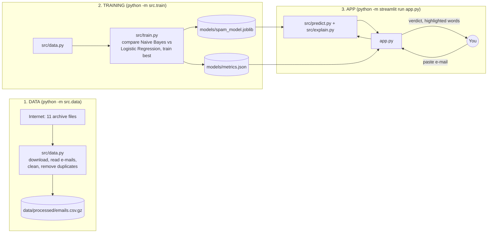
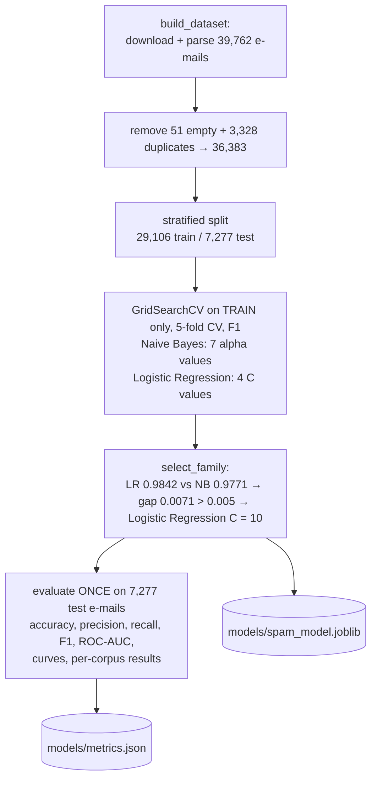
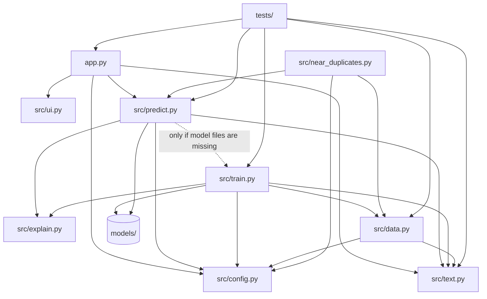

# Project Walkthrough: Email Spam Classifier

A beginner-friendly guide to **every file** in this project: what it does, how its important functions
work, and how an e-mail you paste into the website becomes a "spam / legitimate" verdict with highlighted
words.

Everything here describes the code as it exists in this repository. Numbers marked *real* were produced by
running the actual saved model.

**How to read this:** Sections 1–3 give the big picture. Section 4 is a map of all files. Section 5 explains
each file. Section 6 traces one real e-mail through the whole system step by step. Section 7 explains how the
model was trained. Section 9 is a glossary.

---

## Contents
1. [The project in one minute](#1-the-project-in-one-minute)
2. [Ideas you need first](#2-ideas-you-need-first)
3. [The three stages: data, training, app](#3-the-three-stages-data-training-app)
4. [Map of every file](#4-map-of-every-file)
5. [File-by-file explanation](#5-file-by-file-explanation)
6. [End-to-end flow: from your pasted e-mail to the verdict](#6-end-to-end-flow-from-your-pasted-e-mail-to-the-verdict)
7. [Training flow: what `python -m src.train` does](#7-training-flow-what-python--m-srctrain-does)
8. [How the files depend on each other](#8-how-the-files-depend-on-each-other)
9. [Glossary](#9-glossary)

---

## 1. The project in one minute

You paste an e-mail (subject and body) into a web page. The page answers:
- **"Likely spam"** or **"Likely legitimate"**, with a spam probability (e.g. 99.9%);
- **which words pushed the decision**, coloured red (towards spam) or green (towards legitimate);
- on other tabs, how well the model performed on e-mails it had never seen.

*Spam* is unwanted bulk e-mail. Legitimate e-mail is often called **ham** in spam research.

Behind the page is a **machine-learning model**. *Machine learning (ML)* means the program learns a rule
from examples instead of a programmer writing the rule by hand. The *model* is that learned rule, saved as
numbers in a file. It learned from **36,383 real e-mails from 1999–2005**, each already labelled spam or
legitimate.

> **Important:** this is a *text* classifier. It reads only the words. It does not open links, scan
> attachments or check who sent the e-mail, so a "legitimate" verdict does not mean an e-mail is safe.

---

## 2. Ideas you need first

| Idea | Plain meaning | In this project |
|---|---|---|
| **Feature** | A number the model uses as input | How strongly each word or two-word phrase appears in the e-mail |
| **Label** (also *target* or *class*) | The correct answer | 1 = spam, 0 = legitimate |
| **Training** | Letting the model adjust its internal numbers using labelled examples | `src/train.py` |
| **Prediction** (also *inference*) | Using the trained model on a new input | `src/predict.py`, every time you click Analyse |
| **Binary classification** | Choosing between exactly two categories | spam vs legitimate |
| **Corpus** (plural *corpora*) | A collection of texts used as data | Two e-mail corpora: SpamAssassin and Enron-Spam |
| **NLP** | *Natural Language Processing*: making computers work with human language | Turning e-mail text into numbers |

A computer model can't read words directly, so the core challenge is **turning text into numbers**. That is
done with a technique called **TF-IDF**, explained in §5.2 and §6.

---

## 3. The three stages: data, training, app



- **The data is not stored in this repository** (licence reasons): stage 1 downloads it, about 25 MB.
- **The trained model is included** in `models/`, so the app works immediately without stages 1 and 2.
- An optional extra analysis, `python -m src.near_duplicates`, writes `models/near_duplicates.json` (§5.8).

---

## 4. Map of every file

```
email-spam-classifier/
├── app.py                    ← the website (Streamlit): text box, buttons, charts, 4 tabs
├── src/                      ← the "engine"
│   ├── __init__.py           ← empty; makes src/ an importable Python package
│   ├── config.py             ← settings: paths, download URLs, limits, word lists
│   ├── text.py               ← text cleaning: placeholder tokens, HTML → plain text
│   ├── data.py               ← downloads and reads both e-mail collections, removes duplicates
│   ├── train.py              ← builds TF-IDF + classifiers, picks the best, evaluates, saves
│   ├── explain.py            ← computes how much each word pushed the decision
│   ├── predict.py            ← checks your input, runs the model, prepares highlighting
│   ├── near_duplicates.py    ← optional analysis: do test e-mails have near-copies in training?
│   └── ui.py                 ← styling helpers (banner, result card, footer)
├── models/
│   ├── spam_model.joblib     ← the trained model (TF-IDF vocabulary + classifier weights)
│   ├── metrics.json          ← every number shown on the Model card tab
│   └── near_duplicates.json  ← results of the optional near-duplicate analysis
├── data/                     ← created by "python -m src.data"; NOT in the repository
├── tests/
│   ├── test_model.py         ← checks of text cleaning, parsing, prediction, explanations, metrics
│   └── test_app.py           ← checks of the website without a browser
├── docs/                     ← MODEL_CARD, DATA_SOURCES, DEVELOPMENT_LOG, TESTING
├── .streamlit/config.toml    ← light and dark theme colours
├── requirements.txt          ← exact library versions
├── pytest.ini                ← test-runner settings
├── .gitignore                ← keeps data/, caches and personal notes out of Git
└── README.md
```

**Design rule:** `app.py` is only about what the page looks like. All computation is in `src/`, and nothing
in `src/` uses Streamlit (the web framework), so it can be tested without a browser.

---

## 5. File-by-file explanation

### 5.1 `src/config.py`: shared settings

| Constant | Meaning |
|---|---|
| `DATA_DIR`, `RAW_DIR`, `PROCESSED_PATH`, `MODEL_PATH`, `METRICS_PATH` | Where files are stored (built from the project folder, so they work from anywhere) |
| `SPAMASSASSIN_BASE_URL`, `SPAMASSASSIN_ARCHIVES` | Web address and 5 file names of the SpamAssassin collection; each file name maps to its label (0 or 1) |
| `ENRON_BASE_URL`, `ENRON_ARCHIVES` | Web address and 6 file names (`enron1.tar.gz` … `enron6.tar.gz`) of the Enron-Spam collection |
| `LABELS` | `{0: "legitimate", 1: "spam"}` |
| `CORPUS_IDENTITY_TERMS` | 14 words such as `enron`, `vince`, `houston` that reveal *which collection* an e-mail came from rather than whether it is spam. They are removed so the model can't take that shortcut |
| `RANDOM_STATE = 42` | *Random seed*: a fixed starting point for randomness, so every run gives identical results |
| `TEST_SIZE = 0.2` | 20% of e-mails are kept aside for the final test |
| `CV_FOLDS = 5` | Rounds of cross-validation (see §5.5) |
| `N_JOBS = 4` | How many processor cores the training search may use at once (more cores ran out of memory on a 16 GB laptop) |
| `DEFAULT_THRESHOLD = 0.5` | An e-mail is called spam if its spam probability is ≥ 50% |
| `MIN_WORDS_RELIABLE = 5`, `MAX_CHARS = 50_000` | Input limits used by the website |

---

### 5.2 `src/text.py`: cleaning text

**Regular expressions.** A *regular expression (regex)* is a pattern for finding text, e.g. "anything that
starts with `http://`". This file defines patterns for links (`URL_RE`), e-mail addresses (`EMAIL_RE`),
currency symbols (`MONEY_RE`) and numbers (`NUMBER_RE`). It also has two "spaced" versions for the Enron files,
which write links as `http : / / www . site . com`.

**`normalize(text)`** makes the text lower-case, then replaces:
- links → `urltoken`
- e-mail addresses → `emailtoken`
- `$ £ €` → `moneytoken`
- numbers → `numtoken`

*Why?* Every link is different, so a model would never see the same link twice. Replacing all of them with
one word, `urltoken`, lets the model learn the useful fact "this e-mail contains a link". These replacement
words are called **placeholder tokens**.

Real example: `"...receive a FREE $500 gift card... http://example.com/claim"` becomes
`"...receive a free moneytoken numtoken gift card... urltoken"`.

**`TOKEN_PATTERN`** defines what counts as a word (a *token*): two or more letters a–z.
**Tokenisation** means splitting text into these tokens.

**`html_to_text(markup)`**: many spam e-mails are web pages (HTML). This removes `<script>` and `<style>`
blocks, turns line-break tags into new lines, deletes all other tags, and converts codes like `&nbsp;` back
into normal characters.

**`PLACEHOLDERS`**: friendly names used in charts, e.g. `urltoken` is shown as "[a web link]".

---

### 5.3 `src/data.py`: getting and cleaning the e-mails

Run with `python -m src.data`. It needs internet the first time.

| Function | What it does |
|---|---|
| `_download(url, path)` | Downloads one file if it isn't already on disk. It saves to a temporary `.part` file first, so a broken download never looks complete |
| `_decode_part(part)` | Turns one part of an e-mail into text. Old spam often declares broken *character sets* (*charset*: the rule for turning bytes into letters), so it falls back to a safe one (latin-1) instead of crashing |
| `parse_email(raw)` | Reads one raw e-mail with Python's `email` library. E-mails use the **MIME** format: a header section plus one or more parts (plain text, HTML, attachments). It keeps the **Subject** and the **body**, preferring the plain-text part and otherwise converting the HTML part with `html_to_text`. Headers (servers, dates) are dropped on purpose: a pasted e-mail doesn't have them |
| `read_spamassassin(raw_dir)` | Opens the 5 SpamAssassin `.tar.bz2` archives (*archives* = compressed bundles of many files), skips helper files called `cmds`, and parses every e-mail |
| `parse_enron_file(raw)` | Enron files are already plain text: the first line is `Subject: …`, the rest is the body |
| `read_enron(raw_dir)` | Opens the 6 Enron `.tar.gz` archives; the folder name (`ham` or `spam`) gives the label |
| `build_dataset()` | Combines both collections into one table (a pandas **DataFrame**, a spreadsheet-like object). It builds a `text` column `"Subject: …\n\n<body>"`, removes **empty** e-mails, and removes **exact duplicates**. Returns the table plus statistics |
| `load_dataset()` | Loads the saved `emails.csv.gz` (a compressed CSV table), building it first if needed |

**Why remove duplicates?** If the same e-mail were in both the training data and the test data, the model
would be tested on something it had already seen. That would make the score look better than it really is,
an error called **data leakage**.

Real counts: 39,762 e-mails read → 51 empty and 3,328 duplicates removed → **36,383** (20,019 legitimate,
16,364 spam).

---

### 5.4 `src/explain.py`: why did the model decide that?

Both models used in this project compute their decision as a **sum**:

```
score = starting point + (word value × word weight) + (word value × word weight) + …
```

The score is in **log-odds**. *Odds* = P(spam) ÷ P(legitimate); *log-odds* is the logarithm of that. A score of
0 means 50/50, positive means "more likely spam", and negative means "more likely legitimate". Because it is a
plain sum, **each word's part of the sum is its exact contribution**. No approximation is needed.

| Function | What it does |
|---|---|
| `term_weights(model)` | Gets the weight of every vocabulary term and the starting point. For Logistic Regression: the weights are its *coefficients* (learned numbers) and the starting point is its *intercept*. For Naive Bayes: the weight is log P(word given spam) − log P(word given legitimate), and the start is the class balance |
| `explain(model, text)` | Converts the text with the saved TF-IDF step, multiplies each present term by its weight, and returns: the starting point, every term's contribution (sorted), the total log-odds, and how many known terms were found |
| `global_top_terms(model)` | Lists the 20 most spam-leaning and 20 most legitimate-leaning terms overall (among the 5,000 most common terms), for the Model card chart |

---

### 5.5 `src/train.py`: learning and evaluating

Run with `python -m src.train` (about 7–10 minutes; it downloads the data first if needed).

#### `make_vectorizer()`: the text-to-numbers step
Creates a **TF-IDF vectoriser**: the tool that turns each e-mail into a long list of numbers (a *vector*),
one number per vocabulary term.

- **Vocabulary** = the list of terms the model knows. Here it is the 30,000 most frequent terms from the training e-mails.
- **TF (term frequency)**: how often a term appears in *this* e-mail. `sublinear_tf=True` uses 1 + log(count), so 10 repetitions don't count as 10× the evidence.
- **IDF (inverse document frequency)**: is the term rare across all e-mails? Rare terms get a bigger weight.
- **TF-IDF = TF × IDF**: high when a term is frequent here but rare elsewhere. Each e-mail's vector is then scaled to length 1.

Settings, as written in the code:
- `preprocessor=normalize`: runs the cleaning from §5.2 first.
- `stop_words=…`: ignores very common English words ("the", "and", "here", "now"…) plus the corpus-identity words.
- `ngram_range=(1, 2)`: uses single words *and* two-word phrases. An *n-gram* is a sequence of n words; a *bigram* is 2 words, e.g. "gift card".
- `min_df=2`: ignores terms that appear in only one training e-mail.
- `max_df=0.95`: ignores terms that appear in more than 95% of e-mails.
- `max_features=30_000`: keeps at most 30,000 terms.

Most of the 30,000 numbers are zero for any single e-mail (it uses only a few dozen terms). Such a mostly-zero
vector is called **sparse**.

#### `build_searches(cv)`: two candidate models, each with settings to try
- **Multinomial Naive Bayes**: uses Bayes' theorem, treating each word as independent evidence. Its setting `alpha` (*smoothing*) adds a small count to every word, so an unseen word never makes a probability exactly 0. Tried: 0.001 to 1.0.
- **Logistic Regression**: learns one weight per term directly; the sum of weights is turned into a probability with the *sigmoid* function, `1 / (1 + e^(−score))`. Its setting `C` controls *regularisation*: a penalty that stops weights from becoming too extreme (larger C = weaker penalty). Tried: 1, 10, 100, 1000.

Settings like `alpha` and `C` are **hyperparameters**: chosen before training, not learned. Each candidate is a
**Pipeline** (TF-IDF → classifier) wrapped in **GridSearchCV**, which tries every setting with
**cross-validation**: the training e-mails are split into 5 parts (*folds*), the model is trained on 4 and
scored on the 5th, and this is repeated 5 times and averaged.

The score used is **F1** for the spam class, a single number balancing:
- **precision**: of e-mails flagged as spam, how many really were spam;
- **recall**: of the real spam, how much was caught.

#### `select_family(results)` and `selection_summary(results)`
Rule: **the best average F1 wins, but if Naive Bayes is within 0.005 of the best, pick Naive Bayes** (it is
simpler). `selection_summary` writes down what actually happened. Real outcome: Logistic Regression 0.9842 vs
Naive Bayes 0.9771, a gap of 0.0071, which is more than 0.005, so **Logistic Regression (C = 10)** was selected.

#### `train_and_evaluate()`: step by step
1. `build_dataset()` gets the 36,383 e-mails.
2. **Split** 80/20: 29,106 for training, 7,277 for the final test. The split is *stratified* by collection and label, meaning both parts keep the same mix of corpora and of spam/legitimate.
3. Run both grid searches on the **training part only**.
4. Choose the family; GridSearchCV has already retrained the best setting on all training e-mails (`best_estimator_`).
5. **Test once**: get spam probabilities for the 7,277 test e-mails and apply the 0.5 threshold.
6. Compute the metrics (real values):
   - **Accuracy** 0.9847 (share correct).
   - **Precision** 0.980, **recall** 0.986, **F1** 0.983.
   - **ROC-AUC** 0.9989: the chance that a random spam e-mail gets a higher score than a random legitimate one (1.0 is perfect, 0.5 is guessing). The **ROC curve** plots the true-positive rate against the false-positive rate for every threshold.
   - **Average precision** 0.9986: the area under the **precision–recall curve**.
   - **Confusion matrix** `[[3939, 65], [46, 3227]]` = [[correctly legitimate, legitimate wrongly flagged], [spam missed, spam caught]]. A **false positive** is a legitimate e-mail called spam; a **false negative** is spam that got through.
   - The same metrics **per corpus**, to check the model works on both collections.
7. Store every test e-mail's true label and probability (`y_true`, `y_proba`), so the website can recompute the metrics at any threshold.
8. Store the top terms from `global_top_terms`.

#### `main()`
Saves the model with `joblib.dump(…, compress=3)` (*joblib* saves Python objects to files; *serialisation*)
and the metrics as **JSON** (a plain-text data format), then prints a summary.

---

### 5.6 `src/predict.py`: from your text to a verdict

| Function | What it does |
|---|---|
| `ensure_trained()` | If the model or metrics file is missing, runs training (downloading the data first) |
| `load_model()`, `load_metrics()` | Read the saved files |
| `prepare_text(text)` | Validates input: non-text or empty → error. Longer than 50,000 characters → cut, with a warning. Fewer than 5 words → warning ("unreliable") |
| `classify(model, text, threshold)` | **Main prediction function** (see below) |
| `highlight_segments(text, contributions)` | Splits your original text into pieces (links, e-mail addresses, words, other characters) and attaches each word's contribution, so the page can colour it. Links get the contribution of `urltoken` |
| `metrics_at_threshold(y_true, y_proba, threshold)` | Counts true/false positives and negatives for any threshold; used by the "threshold explorer" |

**`classify` step by step:**
1. Check that the threshold is between 0 and 1.
2. `prepare_text(text)` gives the cleaned text plus warnings.
3. `model.predict_proba([clean])[0, 1]` gives the spam probability. The saved pipeline internally runs normalise → TF-IDF → Logistic Regression.
4. `explain(model, clean)` gives the per-word contributions.
5. If no word was known, add a warning.
6. Return `{text, spam_probability, is_spam (probability ≥ threshold), threshold, warnings, explanation}`.

---

### 5.7 `src/ui.py`: styling helpers
`inject_css()` (CSS = web styling rules; uses semi-transparent colours that work in light and dark mode),
`hero()` (the coloured banner plus the light/dark-mode hint), `result_card()` (the verdict box) and `footer()`.
All text is HTML-escaped (special characters are shown literally, never run as code). `style_fig`, `NEUTRAL`
and `PLOT_MARGIN` are defined here but not currently used by `app.py`.

---

### 5.8 `src/near_duplicates.py`: an honesty check (optional)
Run with `python -m src.near_duplicates` (it needs the downloaded data).

Exact duplicates were removed, but newsletters and spam campaigns send *almost* identical copies. This script
measures, for every test e-mail, its highest **cosine similarity** to any training e-mail. *Cosine similarity*
measures how similar two TF-IDF vectors are, from 0 (nothing in common) to 1 (the same words in the same
proportions). The function `nearest_training_similarity` computes this in blocks of 400 e-mails to save memory.

`main()` then recomputes the scores using only test e-mails *without* a close twin and saves them to
`models/near_duplicates.json`. Real result: 27% of test e-mails have a twin with similarity ≥ 0.9. On the
rest, F1 is 0.975 instead of 0.983. The official evaluation is unchanged; this only adds context.

---

### 5.9 `app.py`: the website

Built with **Streamlit**, a library that turns a Python script into a web page served at
http://localhost:8501. **Key fact:** every interaction (click, typing then leaving the box) makes Streamlit
**re-run the whole script** and redraw the page.
- `@st.cache_resource` on `get_model_and_metrics()` loads the model **once** and reuses it on every rerun (*caching*).
- `st.session_state` is per-visitor memory that survives reruns. The text box is stored under `"message"` and the threshold slider under `"threshold"`.

| Function | Role |
|---|---|
| `EXAMPLES` | Four sample e-mails written for the demo (Prize offer, Account warning, Project update, Invoice). They are not from the training data |
| `get_model_and_metrics()` | Cached: `ensure_trained()`, then load model and metrics |
| `set_example(name)` / `clear_message()` | Button callbacks that put a sample into, or clear, `st.session_state["message"]` |
| `highlighted_html(text, contributions)` | Builds the coloured text: red background for spam-leaning words, green for legitimate-leaning ones, stronger colour = stronger push; hovering shows the number |
| `render_result(result, model_name)` | Verdict card, probability bar with a threshold line, warnings, and four numbers: **Starting point**, **Spam evidence**, **Legit evidence**, **Final score** |
| `render_explanation(result)` | The highlighted text and a bar chart of the strongest words and phrases |
| `render_analyse(model, metrics)` | The **Analyse** tab: sample buttons, text box, Analyse and Clear buttons, an advanced threshold slider, the analysis, and the safety notice |
| `render_model_card(metrics)` | **Model card** tab: metrics, plain-language error summary, 1999–2005 warning, confusion matrix, ROC and precision–recall curves, threshold explorer, per-corpus table, near-duplicate table, model-selection table and outcome, top-terms chart |
| `render_how_it_works(metrics)` | Explains the pipeline and the formula for the selected model |
| `render_dataset(metrics)` | The two collections and their counts before and after cleaning |
| `main()` | Page set-up → load model (friendly error if it fails) → banner → 4 tabs → footer |

Charts are drawn with **Plotly** (interactive charts).

---

### 5.10 `tests/`: automatic checks
Run with `python -m pytest`. *pytest* runs every function named `test_…`; a test fails if an `assert` is false.

- **`test_model.py`** (26 cases):
  - **Cleaning:** placeholders for normal and spaced links and addresses, money, numbers; plain text left alone; HTML cleaning.
  - **Parsing:** MIME prefers plain text; HTML-only e-mails; Enron files.
  - **Validation:** empty, whitespace-only, `None` and number input rejected; short and long text warnings; invalid threshold.
  - **Prediction:** an obvious spam > 0.9, an obvious legitimate < 0.1.
  - **Explanations:** `test_explanation_is_exact` checks that sigmoid(starting point + sum of contributions) equals the model's own probability.
  - **Other:** unknown-word warning; highlighting reassembles the original text.
  - **Stored metrics:** they reproduce the confusion matrix.
  - **Selection consistency:** the selection rule, `metrics.json` and the loaded model all agree.
  - **Reproducibility:** `test_saved_model_reproduces_stored_test_probabilities` is **skipped** if the data hasn't been downloaded.
- **`test_app.py`** (3 tests) uses Streamlit's **AppTest** (runs the page without a browser): the empty state, the sample buttons giving the right verdicts, and the short-message warning plus the threshold change.

A **fixture** prepares shared objects (the model, the metrics) once; **parametrize** runs one test with many inputs.

---

### 5.11 Other files

| File | What it is |
|---|---|
| `models/spam_model.joblib` | The saved Pipeline: TF-IDF (vocabulary + IDF values) + Logistic Regression weights (~0.6 MB) |
| `models/metrics.json` | All evaluation numbers, the selection outcome, test probabilities and top terms |
| `.streamlit/config.toml` | Light and dark theme colours; enables the ⋮ → Settings → Theme switch |
| `requirements.txt` | Exact library versions to install |
| `pytest.ini` | Tells pytest where the tests are and to import from the project folder |
| `.gitignore` | Keeps `data/` (licence), caches, virtual environments and personal notes out of Git |

---

## 6. End-to-end flow: from your pasted e-mail to the verdict

We follow the **"Prize offer"** sample with **real numbers**:

> Subject: Congratulations! You have been selected
> Dear friend, you have been selected to receive a FREE $500 gift card. Click here now to claim your prize:
> http://example.com/claim This offer expires in 24 hours. To be removed from our mailing list, reply REMOVE.

```mermaid
sequenceDiagram
    participant You
    participant App as app.py
    participant Pred as src/predict.py
    participant Model as Saved Pipeline<br/>(normalise → TF-IDF → Logistic Regression)
    participant Exp as src/explain.py
    You->>App: click "Prize offer" (or paste) and Analyse
    App->>App: set_example() fills the text box; script reruns
    App->>Pred: classify(model, text, threshold = 0.5)
    Pred->>Pred: prepare_text(): not empty, ≥ 5 words, < 50,000 chars
    Pred->>Model: predict_proba([text])
    Model-->>Pred: spam probability 0.99913
    Pred->>Exp: explain(model, text)
    Exp-->>Pred: start +0.74, contributions per term, total +7.05
    Pred-->>App: is_spam = True, warnings = [], explanation
    App->>Pred: highlight_segments(text, contributions)
    App-->>You: "Likely spam" 99.9%, numbers, coloured words, signal chart
```

**Step 1. Input.** Clicking the sample runs `set_example("Prize offer")`, which stores the text in
`st.session_state["message"]`. Streamlit reruns the script, and `render_analyse` reads the text.

**Step 2. Validation.** `prepare_text` strips spaces; the text isn't empty, has more than 5 words and is
shorter than 50,000 characters, so there are no warnings.

**Step 3. Normalisation** (inside the model). The real result:
`"subject: congratulations! you have been selected … receive a free moneytoken numtoken gift card. click here now to claim your prize: urltoken … in numtoken hours … reply remove."`

**Step 4. TF-IDF.** The text is split into tokens. Stop words such as "you", "have", "here" and "now" are
dropped, and single words plus two-word phrases are looked up in the 30,000-term vocabulary. Real result:
**36 known terms** get a non-zero TF-IDF value, and the other 29,964 are zero. For example: `remove` 0.128,
`click` 0.103, `gift card` 0.224.

**Step 5. Scoring (Logistic Regression).** Each known term's TF-IDF value is multiplied by its learned weight:

| Term | TF-IDF value | Learned weight | Contribution |
|---|---|---|---|
| remove | 0.128 | +7.527 | **+0.967** |
| click | 0.103 | +6.195 | +0.637 |
| removed | 0.130 | +4.562 | +0.595 |
| gift card | 0.224 | +2.539 | +0.569 |
| reply | 0.122 | +4.442 | +0.543 |
| free | 0.097 | +4.846 | +0.470 |
| … | | | |
| list | 0.092 | −4.598 | −0.421 |
| subject congratulations | 0.209 | −2.914 | −0.608 |
| congratulations | 0.165 | −3.718 | **−0.612** |

Adding everything up:

```
starting point (intercept)    +0.74
spam-leaning terms            +8.54
legitimate-leaning terms      −2.23
──────────────────────────────────
final score (log-odds)        +7.05
```

**Step 6. Probability.** The sigmoid turns the score into a probability: `1 / (1 + e^(−7.05)) = 0.99913`, so
**99.9% spam**. This equals `predict_proba` exactly, and a test checks this for every message it tries.

**Step 7. Decision.** 0.999 ≥ threshold 0.5, so **"Likely spam"**. The probability is more than 0.15 away from
the threshold, so the card adds "well away from the decision threshold".

**Step 8. Highlighting.** `highlight_segments` gives, for example, `Click` +0.637 (red) and the link
`http://example.com/claim` +0.117 (the contribution of `urltoken`, light red). `here` and `now` stay uncoloured
because they are stop words. `highlighted_html` turns this into coloured HTML.

**Step 9. Display.** You see the verdict card, the probability bar, the four numbers above, the coloured
e-mail and a chart of the strongest signals.

For comparison, the real probabilities for the other samples are: Account warning 98.9% spam, Project update
0.25%, Invoice 3.3%.

**Edge cases you can try:**
- An empty box shows the prompt "Paste a message…".
- `hello there` triggers "fewer than 5 words… unreliable".
- Moving the threshold slider to 0.95 changes the threshold used in step 7.

---

## 7. Training flow: what `python -m src.train` does



Why the **test set** is used only once: it is the "final exam". If it influenced any choice, its score
would no longer be an honest estimate. **Cross-validation** acts as the practice exams for making choices.
**Overfitting** means memorising the training e-mails instead of learning general patterns; it shows up as
much worse performance on unseen e-mails.

---

## 8. How the files depend on each other

Arrows mean "imports / uses".



**Important link:** `text.normalize` is stored *inside* the saved model (as the vectoriser's preprocessor).
That's why `src/text.py` must be importable whenever the model is loaded, and why the exact same cleaning
runs during training and during prediction.

---

## 9. Glossary

| Term | Simple meaning |
|---|---|
| **Accuracy** | Share of predictions that are correct |
| **AppTest** | Streamlit tool that runs the page in a test without a browser |
| **Average precision (AP)** | Area under the precision–recall curve; 1.0 is perfect |
| **Bigram / n-gram** | A sequence of 2 / n consecutive words |
| **Caching** | Keeping a result in memory so it isn't recomputed |
| **Charset** | Rule for turning stored bytes into letters |
| **Coefficient / weight** | A number learned by the model for each feature |
| **Confusion matrix** | Table of actual vs predicted classes |
| **Corpus** | A collection of texts |
| **Cosine similarity** | How similar two vectors are, from 0 to 1 |
| **Cross-validation** | Repeated train-and-score rounds on the training data to choose fairly |
| **Data leakage** | Evaluation data accidentally influencing training, which makes scores too optimistic |
| **DataFrame** | A table object from the pandas library |
| **Deduplication** | Removing repeated items |
| **F1-score** | One number balancing precision and recall |
| **False positive / negative** | Legitimate mail called spam / spam that got through |
| **Feature** | A numeric input to the model |
| **GridSearchCV** | Tries every combination of hyperparameter values with cross-validation |
| **Ham** | Legitimate (non-spam) e-mail |
| **HTML** | The markup language of web pages; many e-mails are written in it |
| **Hyperparameter** | A setting chosen before training (e.g. `C`, `alpha`) |
| **IDF** | Inverse document frequency: larger for rarer terms |
| **Intercept** | A logistic regression's starting score before any word is counted |
| **joblib** | Library for saving and loading Python objects |
| **JSON** | Plain-text format for structured data |
| **Log-odds** | log(P(spam) / P(legitimate)); 0 means 50/50 |
| **Logistic Regression** | Weighted sum of features → sigmoid → probability |
| **MIME** | The standard structure of an e-mail (headers + parts) |
| **Multinomial Naive Bayes** | Text classifier based on Bayes' theorem that treats words as independent evidence |
| **Near-duplicate** | Two texts that are almost, but not exactly, the same |
| **NLP** | Natural Language Processing |
| **Overfitting** | Memorising training data instead of learning general patterns |
| **Pipeline** | Several processing steps chained into one object |
| **Placeholder token** | A fixed word replacing variable content (e.g. `urltoken` for any link) |
| **Precision** | Of the items flagged as spam, the share that really were spam |
| **Recall** | Of the real spam, the share that was caught |
| **Regex (regular expression)** | A text-matching pattern |
| **Regularisation (`C`)** | A penalty that keeps weights from becoming extreme; larger C = weaker penalty |
| **ROC curve / ROC-AUC** | Trade-off curve between catching spam and false alarms / the area under it (1.0 is perfect) |
| **Sigmoid** | `1 / (1 + e^(−x))`: turns any number into a probability between 0 and 1 |
| **Smoothing (`alpha`)** | Small count added in Naive Bayes so no probability is exactly 0 |
| **Sparse vector** | A vector that is mostly zeros |
| **Stop words** | Very common words ignored by the model ("the", "and", "here"…) |
| **Stratified split** | A split that keeps the same class mix in each part |
| **Session state** | Streamlit's per-visitor memory across reruns |
| **Test set / training set** | Data kept for the final check / data used for learning |
| **TF-IDF** | Term frequency × inverse document frequency: a word's importance in one document relative to all documents |
| **Threshold** | The probability above which an e-mail is called spam (default 0.5) |
| **Token / tokenisation** | A unit of text (here, a word) / splitting text into tokens |
| **Vector** | An ordered list of numbers |
| **Vocabulary** | The set of terms the model knows (30,000 here) |
