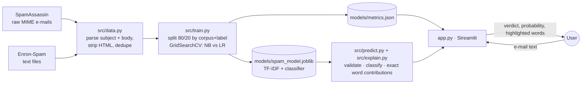

# ✉️ Email Spam Classifier

A text-classification web application that reads an e-mail (subject and body), predicts whether it is
**spam** or **legitimate**, and shows **exactly which words drove the decision**.

**Author:** Arya Kumar · AI/ML internship project

---

## Problem statement

Unwanted bulk e-mail (spam) wastes time and is a common carrier for scams. A spam filter must decide from
the content of a message whether to deliver it. The task is to build a classifier that learns this from
labelled e-mails, measure it honestly, and present it as a small service that explains its verdicts
instead of acting as a black box.

### Objectives
1. Build a reproducible NLP pipeline (parsing → normalisation → TF-IDF → classifier) on real e-mail corpora.
2. Compare Multinomial Naive Bayes (the classic baseline) with Logistic Regression using cross-validation.
3. Evaluate on held-out data with metrics suited to an imbalanced, cost-sensitive problem.
4. Show word-level explanations, and make clear what a text classifier cannot detect.

## Features

| Area | What it does |
|---|---|
| **Analyse** | Paste any e-mail or load one of four samples; get a verdict, a spam probability and the decision threshold |
| **Word highlighting** | Every word coloured by how strongly it pushed towards spam (red) or legitimate (green) |
| **Score breakdown** | Starting point + spam evidence + legitimate evidence = final score (exact, not approximate) |
| **Adjustable threshold** | Trade false alarms against missed spam |
| **Input checks** | Empty input rejected; very long input truncated; very short input flagged as unreliable; warning when no known words are present |
| **Safety notice** | Clearly states that it does not scan links or attachments, check senders, or guarantee safety |
| **Model card** | Test metrics, confusion matrix, ROC and precision–recall curves, **threshold explorer**, per-corpus results, hyperparameter search, most indicative terms |
| **How it works / Dataset** | Pipeline, formulas, limitations, corpus composition and cleaning statistics |

## Technology stack

Python 3.13 · scikit-learn 1.9 (TfidfVectorizer, MultinomialNB, LogisticRegression, GridSearchCV) ·
pandas · Streamlit 1.66 · Plotly · joblib · pytest (including Streamlit `AppTest`).

## Datasets

| Corpus | Years | E-mails after cleaning | Spam share |
|---|---|---|---|
| [Apache SpamAssassin public corpus](https://spamassassin.apache.org/old/publiccorpus/) | 2002–2005 | 5,922 | 30.6% |
| [Enron-Spam](https://www2.aueb.gr/users/ion/data/enron-spam/) (Metsis, Androutsopoulos & Paliouras, CEAS 2006) | 1999–2005 | 30,461 | 47.8% |
| **Combined** | | **36,383** | **45.0%** |

Neither corpus has an open licence (copyright in the messages remains with their senders), so **the data
is not included in this repository**. `python -m src.data` downloads it (about 25 MB). See
[docs/DATA_SOURCES.md](docs/DATA_SOURCES.md).

## Architecture



## Quick start (Windows PowerShell)

Requires **Python 3.11 or newer** (tested with 3.13.1 on Windows 11). Run these from a PowerShell window:

```powershell
# 1. Go to the project folder (the one containing app.py)
cd path\to\email-spam-classifier

# 2. First time only: create a virtual environment and install the dependencies
py -3.13 -m venv C:\venvs\spam
C:\venvs\spam\Scripts\Activate.ps1
python -m pip install -r requirements.txt

# 3. Every time: activate the environment and start the app
C:\venvs\spam\Scripts\Activate.ps1
python -m streamlit run app.py
```

The app opens at **http://localhost:8501**. Stop it with `Ctrl + C`. Run the tests with `python -m pytest`
(29 tests).

- **Data:** The e-mail corpora are **not** in the repository (licence). The app does not need them, because the trained model is included. They are needed only to retrain or to run the data-dependent test: `python -m src.data` downloads about 25 MB into `data/` (internet required).
- **Model:** The trained model (`models/spam_model.joblib`) is included. Retrain: `python -m src.train` (about 7–10 minutes; downloads the data first if missing). Near-duplicate analysis: `python -m src.near_duplicates`.
- **Light / dark mode:** open the **⋮** menu (top right) → **Settings** → **Theme**.
- Without the downloaded data, `python -m pytest` reports **28 passed, 1 skipped** (the skipped test re-checks predictions against the raw data).

> The virtual environment is created at a short path outside the project folder on purpose: inside a long
> OneDrive path, Windows' 260-character path limit can break the installation (`WinError 206`), and
> OneDrive would sync ~500 MB of packages. If `py -3.13` is not available, use `python -m venv C:\venvs\spam`.

### Common startup problems

| Symptom | Fix |
|---|---|
| `Activate.ps1 cannot be loaded because running scripts is disabled` | Run `Set-ExecutionPolicy -Scope Process -ExecutionPolicy Bypass`, then activate again (affects this window only) |
| `streamlit` / `python` is not recognised, or `ModuleNotFoundError` | The environment is not active: run the `Activate.ps1` line again; always start the app with `python -m streamlit run app.py` |
| `ModuleNotFoundError: No module named 'src'` | You are not in the project folder; `cd` into the folder that contains `app.py` |
| `Port 8501 is already in use` | Another app is running; stop it, or use `python -m streamlit run app.py --server.port 8502` |
| `WinError 206: The filename or extension is too long` during `pip install` | Create the environment at a short path such as `C:\venvs\spam` (as above) |
| The browser does not open | Open http://localhost:8501 manually |

## How to use

1. Click **Prize offer** or **Account warning** (spam-like samples) or **Project update** / **Invoice**
   (legitimate samples). These samples were written for the demo and are not from the training data.
2. Read the verdict and probability, then the highlighted text: which words were red or green?
3. Paste your own e-mail. Try a very short message to see the reliability warning.
4. Open **Advanced: decision threshold** and raise it to 0.9; then see the measured effect in **Model card → Threshold explorer**.

## Results (held-out test set: 7,277 e-mails)

**Selected model:** TF-IDF (unigrams + bigrams, 30,000 terms) + **Logistic Regression (C = 10)**.

| Metric (spam = positive class) | Value |
|---|---|
| Accuracy | **98.47%** |
| Precision | 0.980 |
| Recall | 0.986 |
| F1-score | **0.983** |
| ROC-AUC | 0.9989 |
| Legitimate e-mails wrongly flagged | 65 of 4,004 (1.6%) |
| Spam missed | 46 of 3,273 (1.4%) |

Five-fold CV F1 on the training split: Logistic Regression **0.9842** (best C = 10) vs Multinomial Naive
Bayes 0.9771 (best α = 0.01). The difference (0.0071) exceeds the pre-declared 0.005 tolerance, so the
tie-break in favour of Naive Bayes was not triggered and Logistic Regression was selected. The saved
model, the stored metrics and the selection rule are checked against each other by a test.

**Near-duplicate check:** 27% of test e-mails have a near-identical twin in the training data (TF-IDF
cosine ≥ 0.9). On the remaining e-mails F1 is **0.975**, the fairer figure for genuinely new e-mails
(`python -m src.near_duplicates`).

**These scores are for 1999–2005 e-mail** from the same corpora; performance on modern spam was not measured.

| Corpus (test split) | E-mails | F1 | ROC-AUC |
|---|---|---|---|
| Enron-Spam | 6,092 | 0.986 | 0.9991 |
| SpamAssassin | 1,185 | 0.959 | 0.9982 |

**Threshold trade-off (test set):** at 0.5, 65 false alarms and 46 missed spam; at 0.9, only 5 false alarms
but 330 missed spam.

## Repository structure

```
email-spam-classifier/
├── app.py                   # Streamlit UI (Analyse · Model card · How it works · Dataset)
├── requirements.txt · pytest.ini · .gitignore · .streamlit/config.toml
├── src/
│   ├── config.py            # paths, URLs, settings, corpus-identity stop-words
│   ├── data.py              # download + parse both corpora, clean, deduplicate
│   ├── text.py              # normalisation (URLs, e-mails, numbers → tokens), HTML → text
│   ├── train.py             # grid search, selection rule, evaluation, saving
│   ├── explain.py           # exact per-term contributions for NB and LR
│   ├── predict.py           # input validation, classify, highlighting, threshold metrics
│   └── ui.py                # styling helpers
├── models/                  # spam_model.joblib (0.6 MB) + metrics.json + near_duplicates.json
├── tests/                   # test_model.py (26) + test_app.py (3)
└── docs/                    # MODEL_CARD · DEVELOPMENT_LOG · DATA_SOURCES · TESTING
```

## Limitations
- **Old data (1999–2005).** Modern spam and phishing use different wording, so real-world accuracy will be lower than the test score.
- **Text only.** It does not open links, inspect attachments or images, or check sender, headers or domains.
- **Domain bias.** Legitimate training e-mail is mostly technical mailing lists and one energy company's business mail.
- **Short messages are unreliable.** For example, "hello there" is scored as spam because "hello" is a common spam greeting.
- Logistic regression probabilities are reasonable but not formally calibrated.

## Future improvements
- Add a recent corpus (and recent phishing e-mail) to reduce the age gap.
- Calibrate probabilities (`CalibratedClassifierCV`) and evaluate with a reliability diagram.
- Batch scoring of a CSV file; a REST API endpoint.

## Documentation
[Model card](docs/MODEL_CARD.md) · [Development log](docs/DEVELOPMENT_LOG.md) ·
[Data sources](docs/DATA_SOURCES.md) · [Testing](docs/TESTING.md)
